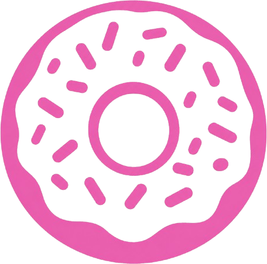

# Open Proficiency

The Open Proficiency framework provides a distributed model and tooling for quantifying an individual's familiarity with tools and skills.

The [Open Proficiency Model (OPM)](https://github.com/openproficiency/model) consists of 3 main components:

- **Topic Lists** - specifying the trackable things a person can be "know"
- **Transcripts** - securely storing a user's topic scores.
- **Interpretations** - combining different topics to define badges, levels, job roles, etc.

### Resources

- [Model Schema](https://github.com/openproficiency/opm-go) - the detailed specifications and schemas to enable building custom applications compliant with open proficiency
- [Go Library](https://github.com/openproficiency/opm-go) - native Go types and operations for the full lifecycle of proficiency data
<!-- - [Typescript Library](https://github.com/openproficiency/opm-go) - native Typescript types and operations for the full lifecycle of proficiency data -->

### Contributing

Pull requests are welcome on any of the project repositories.
For inspiration to get started, please see the [public project board](https://github.com/orgs/openproficiency/projects/1/views/1).
